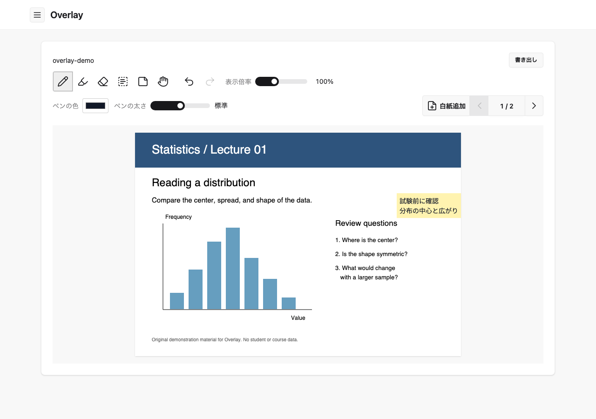

# Overlay

PDFにペン・テキスト・付箋を重ねて、あとから編集を再開できるWebアプリです。大学の配布資料へのメモと、付箋からの見返しを主な用途としています。

[公開サイト](https://overlay-virid.vercel.app/) · [ソースコード](https://github.com/momijyu/Overlay)



画面内のPDFは、表示例として作成したサンプル資料です。

## 使用方法

1. サイトで「PDFを追加」からPDFを選びます。
2. ペン・マーカーで書くか、テキスト・付箋を追加します。確定した編集から自動保存が始まります。PDFを開いただけでは保存されません。
3. 左上の三本線からノート一覧を開き、保存したノート名を押して編集を再開します。
4. 「書き出し」（スマホは右上の「…」）から、閲覧・共有用の「PDFをダウンロード」か、再編集用の「編集用バックアップ」を選びます。

ローカル利用にログインやGoogleの設定は不要です。Google Driveを使う場合は、ノート一覧の下にある「Google Drive」欄の「接続設定」から接続します。接続先の確認後、このブラウザの全ノート・フォルダが自分のDriveへの自動保存対象になります。

Google連携の一般利用者向け公開設定・全対象端末での通し確認は進行中です。公開URLの存在だけで、それらの確認完了を示すものではありません。

## 主な操作

| 操作 | 方法 |
| --- | --- |
| 書き込み | ペン・マーカーを選択。色と太さはそれぞれ設定可能 |
| 消す | 消しゴムで触れた部分を消去。元PDFは変更しない |
| 文章・付箋 | 道具を選び、追加ボタンまたはページ上の空白を押す。直接入力後、完了または外側クリックで確定 |
| 文字サイズ・色 | 編集中のスライダー／数値入力と色設定。箱の寸法は文章に合わせて自動調整 |
| Undo / Redo | 矢印ボタン。直近100操作まで。ノート切り替え・再読み込みで履歴をリセット |
| 拡大・移動 | 倍率スライダー、Ctrl／Command＋ホイール、二本指のピンチ。「移動・閲覧」でページを移動 |
| ページ・白紙 | ページ矢印で切り替え。「白紙追加」で現在のページの直後へ挿入 |
| 見返す | 一覧内の「付箋一覧」から資料・ページへ移動。すべての付箋を自動掲載。Driveの未取得資料も索引から表示 |
| 整理 | フォルダ作成、操作メニューの名前変更・移動・削除。PCはドラッグ、タッチは約400ms長押しで移動 |
| 複数操作 | 「選択」でチェックし、一括移動・削除・ZIP保存。フォルダのチェックは子孫へ反映 |

削除は対象と件数を確認して実行します。完了後は元に戻せません。選択・削除・タッチ操作の詳細は[操作説明](docs/mobile-operations.md)、文章入力は[テキストと付箋](docs/text-notes.md)を参照してください。

## 保存とバックアップ

| 方法 | 用途と保存内容 |
| --- | --- |
| ブラウザ内保存 | 未連携時の通常保存先。元PDFと編集情報・階層をIndexedDBへ保存 |
| Google Drive | 連携後の保存先。本人のOverlayフォルダへ階層と端末別の編集データを保存。端末には一覧・キャッシュ・未送信内容を保持 |
| PDFをダウンロード | 書き込みを反映した閲覧・共有用PDF。名前はノート名を使用。編集オブジェクトや階層の完全復元用ではない |
| `.overlay` / `.zip` | 元PDF・再編集可能な書き込み・階層をまとめる保管用ファイル。暗号化はしない |

単独ノート・フォルダは「操作」から、複数項目は「選択 → 編集用ZIPで保存」から書き出せます。「全選択」も使用できます。復元は「バックアップを読み込む」から件数を確認し、既存ノートを上書きせずコピーを追加します。安全上限は1ファイル合計256MiB・200ノート・1000フォルダなどで、大きい場合は小分けにします。[バックアップ仕様](docs/note-backups.md)

Drive未接続時は、端末にPDFと編集本文がそろったノートとその付箋だけを一覧に表示します。再接続するとDrive内のノートも表示し、本文未取得のノートには雲が付きます。端末にPDFと編集本文がそろっていれば雲は付きません。再取得可能キャッシュは初期250MB、設定範囲100〜1,000MB、未使用保持30分です。使用中・未送信・失敗・ローカル専用データは整理しないため、ブラウザ全体の使用量の上限ではありません。

アプリ内の削除はDriveの共通一覧にも反映しますが、Drive上のPDF・編集JSONを自動で削除しません。キャッシュ整理もDriveの実体削除とは別です。[Driveの保存・競合・容量](docs/drive-storage.md)

Driveの資料は通常のノート一覧から開きます。「接続設定」画面では接続先を確認・変更できます。自動保存とは別に保管したい場合は、ノートの「操作」や複数選択の「Driveにバックアップ」から進みます。以前のDriveバックアップの復元は「バックアップを読み込む → 以前のDriveバックアップから」へ進みます。復元前の確認と重複判定を行います。

## 対応環境と制約

- Chromeを中心に開発しています。スマホ・iPad向けの縦横UIとタッチ操作を実装していますが、端末・ブラウザ別の通し確認は継続中です。Safariの過去の表示・入力不具合も、すべて解決済みとは扱っていません。
- Drive自動保存にはHTTPSまたはlocalhostと、Web Locks・Web Crypto対応が必要です。LAN内のHTTPアクセスは同じ条件になりません。
- ブラウザ保存は端末・ブラウザ・URLのoriginごとに別です。サイトデータ削除、プライベートブラウズ終了、ブラウザのデータ整理等で失う場合があります。重要なノートは定期的に書き出してください。
- Drive認可はブラウザのメモリに保持します。ページ再読み込み・期限切れ後は再接続が必要です。未送信の編集は端末に保護しますが、送信完了前の端末データ消去・強制終了まで保証しません。
- 他端末との競合は検出し、「今後使う内容」を選択します。採用の決定もDriveへ保存するため、新しい変更がない限り同じ確認を繰り返しません。選ばなかった版の実ファイルは残します。共同リアルタイム編集・自動マージ・閉じたブラウザからの送信は対応していません。
- PDFの元の文字の編集、一般的なページ削除・並び替え、OSフォルダへの直接保存はありません。

第6回の残作業を引き継ぎ、第7回のUI・保存表示の改善を進めています。[第7回の実施・残作業](docs/phase7-checks.md)へ記録しています。[第6回の実施・確認記録](docs/phase6-checks.md)も参照できます。

## 開発環境の起動方法

Node.js 24.18以降とnpmを使用します。

```bash
npm ci
npm run dev
```

ブラウザで `http://localhost:3000` を開きます。ポートを変えるとブラウザの保存領域も変わるため、普段の保存先と同じURLを使ってください。

ローカル保存に環境変数は不要です。Driveを使う場合だけ、[Google Cloud設定手順](docs/google-drive-setup.md)に従ってOAuthクライアントIDを `.env.local` に設定します。クライアントシークレットは使用しません。`.env.local` をGitに追加しないでください。

```bash
npm test
npm run lint
npx tsc --noEmit --incremental false
npm run build
npm start
```

テストはNode標準のテスト機能・fake-indexeddb・仮のDrive APIを使用し、実際のブラウザやDriveのデータは変更しません。本番ビルドは現在webpackを指定しています。テスト用の実験機能警告と、実際の失敗は区別してください。

動作の遅さを調べる場合は、「接続設定 → 速度計測」で開始し、操作後に停止・結果保存します。本文や認証情報を含まないJSONを端末へ出力します。[計測手順と結果の読み方](docs/drive-performance.md)

## 技術スタック

| 用途 | 技術 |
| --- | --- |
| アプリ | Next.js・React・TypeScript |
| UI | Tailwind CSS・daisyUI・SVG |
| PDF表示 | PDF.js（Worker・標準フォント・CMapを同梱） |
| PDF出力 | pdf-lib・@pdf-lib/fontkit・Noto Sans JP |
| 端末保存 | IndexedDB・Web Locks |
| Drive連携 | Google Identity Services・Google Drive API（drive.file） |
| 編集用バックアップ | fflateによる無圧縮ZIP |
| 検証 | Node.js Test Runner・fake-indexeddb・ESLint・TypeScript |
| 配信 | Vercel・GitHub |

正確なバージョンは [package-lock.json](package-lock.json) で固定しています。Supabase・SQLite・独自アカウントサーバーは使用しません。

## 構成

```text
src/app/                    ページ・共通レイアウト・CSS・health API
src/components/             共通UI
src/features/pdf-editor/    PDF編集・端末保存・Drive連携・バックアップ
public/                     フォント・PDF.js資産・ライセンス
tests/                     仮DB・仮APIでの自動テスト
docs/                      操作・設計・確認記録
```

PDFの解析・編集・端末保存・Drive API呼び出しはブラウザ側で行います。アプリのサーバーへPDFをアップロードする方式ではありません。[コードの役割](docs/execution-locations.md) · [正式仕様](PROJECT.md) · [制作計画](software_creation_plan.txt) · [ペルソナ設計](docs/persona-design.md)

## ライセンス・クレジット

| 同梱資産 | 出典・ライセンス |
| --- | --- |
| 編集・クラウドアイコン | [Lucide 1.59.0](https://github.com/lucide-icons/lucide/tree/1.59.0)、ISC／Feather由来MIT。[取得元](docs/icon-sources.md)・[全文](public/licenses/lucide-LICENSE.txt) |
| 日本語フォント | Noto Sans JP、SIL OFL 1.1。[取得元](public/fonts/README.md)・[全文](public/fonts/OFL.txt) |
| ZIP処理 | fflate、MIT。[全文](public/licenses/fflate-LICENSE.txt) |
| PDF.js CMap | Adobe、BSD 3-Clause。[全文](public/pdfjs/cmaps/LICENSE)・[取得元](public/pdfjs/README.md) |
| PDF.js標準フォント | [Foxit](public/pdfjs/standard_fonts/LICENSE_FOXIT)・[Liberation](public/pdfjs/standard_fonts/LICENSE_LIBERATION)の同梱条件 |

その他の依存パッケージにもそれぞれのライセンスが適用されます。Overlay独自コードのライセンス方針は、2026年11月9日の利用者指定で保留しています。第三者資産の許諾をアプリ全体の許諾として扱わないでください。資料として開くPDFや書き込む内容についても、利用者が共有・配布できる範囲を確認してください。
